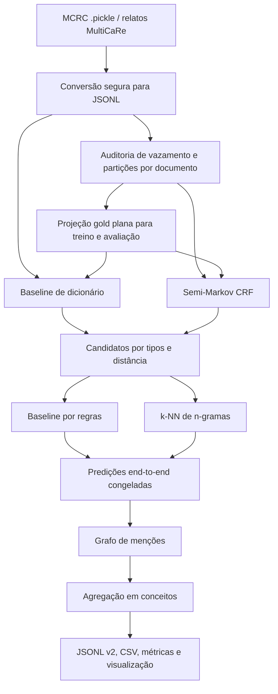

# MC896 - Projeto 2

Extração supervisionada de informações clínicas do **Medical Case Report
Corpus (MCRC)**, avaliação externa em relatos do **MultiCaRe** e representação
dos resultados como um **Knowledge Graph**.

## Estrutura

O Projeto 2 preserva os módulos clássicos do Projeto 1, mas acrescenta dados e
anotações supervisionadas, treinamento de modelos, avaliação reproduzível e um
contrato versionado para o grafo. A organização detalhada está descrita em
[Organização do Projeto](#organização-do-projeto).

## Objetivo

O objetivo do Projeto 2 foi evoluir a extração baseada em dicionários, regex e
regras do Projeto 1 para um estudo supervisionado completo. Foram implementados
um reconhecedor de entidades por semi-Markov CRF, um classificador de relações
por k-NN, baselines determinísticos, validação cruzada, análise de erros,
avaliação externa e projeção das previsões em grafo de conhecimento.

## Dados

O Medical Case Report Corpus (MCRC), derivado de artigos do PubMed Central e
disponibilizado pela Ada Health, é a fonte supervisionada de desenvolvimento.
O arquivo original em formato `.pickle` fica em `data/secure` e é convertido
para um formato seguro antes do uso. Dados brutos, textos clínicos e artefatos
sensíveis não são versionados; manifestos registram sua origem, configuração e
hashes após o processamento.

O MCRC possui 53 documentos, 4.294 anotações de menção feitas manualmente e
2.975 relações nativas. Após o mapeamento para o esquema inicial e a aplicação
dos contratos do projeto, 2.906 relações integram o dataset supervisionado.

Os rótulos originais utilizados para descrição de entidades e relações no MCRC são:

| Tipo | Campo | Rótulos |
| :--- | :--- | :--- |
| Entidades | `entityType` | `finding`, `factor`, `condition`, `modifier` |
| Relações | `type` | `has`, `modifies`, `causes` |

**Nó de paciente implícito:** nenhuma entidade é do tipo `case`. O nó de origem de todas as relações `has` (o paciente) não existe entre as anotações.

## Preparação dos dados

A primeira parte do projeto consistiu na implementação de um pipeline de sanitização e preparação dos dados. Como a intenção é treinar o modelo para receber e classificar o dataset do MultiCaRe, expô-lo a esses dados durante o treinamento e a validação causaria data leakage e enviesaria o modelo. Por isso, definimos um processo de auditoria de segurança pelo qual os dados passam antes de serem liberados para uso no aprendizado de máquina. Os principais passos dessa fase são:

### Conversão do `.pickle` em `.jsonl`

O arquivo `.pickle` do MCRC é convertido em um `.jsonl`, que armazena um objeto JSON por linha, com chaves para dados e metadados provenientes do dataset original. Cada linha do arquivo pós-processado tem o seguinte formato:

```json
{
  "document_id": "",
  "text": "",
  "metadata": {},
  "cases": [
    {
      "case_id": "",
      "source_id": "",
      "provenance": {}
    }
  ],
  "patients": [
    {
      "patient_id": "",
      "attributes": {}
    }
  ],
  "mentions": [
    {
      "mention_id": "",
      "canonical_type": "",
      "native_types": [],
      "spans": [
        []
      ]
    }
  ],
  "relations": [
    {
      "relation_id": "",
      "source_id": "",
      "target_id": "",
      "canonical_label": "",
      "native_label": ""
    }
  ]
}
```

Os rótulos de entidades e relações nativos do MCRC foram convertidos para entidades e relações canônicas. A conversão segue as tabelas:

| MCRC | Canônico P2 |
| :--- | :--- |
| nó implícito | Patient |
| `condition` (ex.: Crohn's disease) | Condition |
| `finding` (ex.: pain, fever, liver, liver function tests) | Finding |
| `factor` (ex.: woman, 49-year-old, hypertension) | Factor |
| `modifier` (ex.: no, normal, negative) | Modifier |

| MCRC | Canônico P2 |
| :--- | :--- |
| `has` → condition | `HAS_CONDITION` (Patient → Condition) |
| `has` → finding | `HAS_FINDING` (Patient → Finding) |
| `has` → factor | `HAS_FACTOR` (Patient → Factor) |
| `modifies` | `NEGATES` (Modifier → Finding) |
| `causes` | `CAUSES` (Condition → Finding) |
| sintética | `DESCRIBES` (Case → Patient) |

Para garantir a integridade da fonte de dados, o conversor exige o hash SHA-256 do dataset original como credencial de entrada.

#### Comando utilizado na conversão

Converter o arquivo `.pickle` em `.jsonl`:
```python
python -m project2_from_project1.scripts.convert_mcrc \
  --artifact project2_from_project1/data/secure/CaseReportCorpus.pickle \
  --output-jsonl project2_from_project1/data/secure/mcrc.jsonl \
  --manifest project2_from_project1/data/secure/mcrc.manifest.json \
  --repository "https://github.com/adahealth/medical_case_report_corpus" \
  --revision "b12fbc3b42d7572f26563bd50ee48ee4a6036c3d" \
  --sha256 "9afe5fc78b97860615365b41736701ea03d894d3440bb167e9b6cf9e6fc1f962" \
  --allow-unsafe-deserialization
```

### Geração do dataset de treino, validação e teste

Para gerar o dataset fixo de treino, validação e teste, utilizamos um pipeline focado em controle de contexto e bloqueio de data leakage. Com um script Python, geramos um manifesto de fingerprints, que armazena hashes SHA-256 dos textos do MultiCaRe utilizados no Projeto 1. 

O pipeline compara cada documento do MCRC com os fingerprints do MultiCaRe e atribui um de três estados, aplicando as regras nesta ordem:

| Ordem | Regra | Critério | Decisão |
| :--- | :--- | :--- | :--- |
| 1 | `identifier_match` | PMCID, PMID ou DOI iguais aos de um artigo protegido | **Excluído** |
| 2 | `content_hash_match` | SHA-256 do texto normalizado igual ao de um documento protegido | **Excluído** |
| 3 | `text_similarity_threshold` | Similaridade ≥ **0,85** e pelo menos **3 shingles** em comum | **Quarentena** (revisão manual) |
| 4 | `similarity_below_threshold` | Nenhuma das condições acima | **Liberado** |

Detalhes da comparação por similaridade:

- O texto é dividido em *shingles*: sequências de 5 tokens consecutivos, representadas por um hash.
- A similaridade é a proporção de shingles compartilhados em relação ao menor dos dois conjuntos (`interseção / min(|A|, |B|)`), e não o índice de Jaccard. Assim, um caso clínico copiado dentro de um artigo maior continua sendo detectado, sem ser diluído pelo restante do texto.
- A comparação é feita tanto sobre o documento inteiro quanto sobre trechos de 120 tokens com passo de 60, o que detecta cópias parciais. Vale o maior dos dois scores.
- Exigir ao menos 3 shingles em comum (equivalente a pelo menos 7 tokens consecutivos iguais) evita que frases genéricas curtas, comuns em texto clínico, mandem um documento para a quarentena.

Documentos **excluídos** ou em **quarentena** não podem ser enviados ao treinamento. Um documento em quarentena só é liberado após checagem manual.

A divisão do dataset reserva 20% dos documentos para teste e utiliza o restante
em validação cruzada com cinco folds. Em cada rodada, um fold é usado para
validação e os demais para treino, de modo que cada documento de
desenvolvimento participe da validação exatamente uma vez. A separação é feita
por documento, impedindo que menções do mesmo caso apareçam dos dois lados da
fronteira experimental. Ao fim da auditoria inicial, nenhum documento do MCRC
foi excluído ou colocado em quarentena.

Os arquivos que armazenam os conjuntos de validação, treino e teste guardam apenas chaves estrangeiras que referenciam o documento equivalente no arquivo JSONL que armazena os dados brutos e metadados. As chaves presentes em cada objeto JSONL do dataset são:

| Chave | Descrição |
| :--- | :--- |
| `candidate_relation` | Tipo de relação avaliada como hipótese entre as duas entidades (ex.: `CAUSES`, `NEGATES`, `HAS_CONDITION`, `HAS_FACTOR`, `HAS_FINDING`). |
| `document_id` | Identificador único do documento de origem, geralmente referenciando o diretório, a URL ou o ID de publicação do caso clínico (ex.: `PMC3017697`). |
| `gold_relation_id` | Identificador da relação no conjunto anotado (padrão-ouro) caso ela seja verdadeira, ou `null` caso seja um pareamento sem relação válida. |
| `label` | Classe definitiva da instância, usada como valor real (*ground truth*) que o modelo deve aprender a prever. Assume um valor de relação (ex.: `NEGATES`, `CAUSES`) ou `NO_RELATION` para relações falsas. |
| `sentence_distance` | Distância, em número de sentenças, entre a menção de origem e a menção alvo no texto original (inteiro como 0, 1, 65, ou `null`). |
| `source_id` | Identificador único e posicional da menção de origem (*source*) dentro do documento. |
| `source_type` | Tipo canônico atribuído à entidade de origem (ex.: `Condition`, `Modifier`, `Patient`). |
| `target_id` | Identificador único e posicional da menção alvo (*target*) dentro do documento. |
| `target_type` | Tipo canônico atribuído à entidade alvo (ex.: `Finding`, `Factor`, `Condition`). |

#### Comandos para gerar os fingerprints e as partições

Gerar as impressões digitais da coleção protegida (MultiCaRe, Projeto 1),
usadas na auditoria de vazamento:
```python
python -m project2_from_project1.scripts.seal
```

Gerar o dataset de treino e validação (janela de uma sentença; `-1` remove o
limite):
```python
python -m project2_from_project1.scripts.reproduce_first_milestone prepare \
  --safe-jsonl project2_from_project1/data/secure/mcrc.jsonl \
  --protected-collection project2_from_project1/data/secure/multicare.fingerprints.json \
  --output-directory project2_from_project1/artifacts/first-milestone \
  --seed 42 --test-fraction 0.2 --folds 5 \
  --maximum-sentence-distance 1 --maximum-train-negatives-per-positive 2
```
### Exemplo prático de dataset gerado para um texto genérico

Dado um texto de caso clínico genérico, rotulado com as bases do MCRC, o dataset de treino gerado seguiria o seguinte padrão:

> *clinical text:* "A patient presents to the emergency department reporting a sudden onset of intense chest discomfort that began about an hour ago. The pain is described as a heavy pressure in the center of the chest. The clinical presentation raises immediate concern and warrants urgent investigation."

Exemplo de linha gerada:

```json
{
  "candidate_relation": "HAS_FINDING",
  "document_id": "mcrc:emergency_case_001",
  "gold_relation_id": "mcrc:emergency_case_001:relation:854",
  "label": "HAS_FINDING",
  "sentence_distance": 0,
  "source_id": "mcrc:emergency_case_001:patient:101",
  "source_type": "Patient",
  "target_id": "mcrc:emergency_case_001:mention:102",
  "target_type": "Finding"
}
```

- **A relação (`candidate_relation` e `label`):** estamos testando a relação `HAS_FINDING` (tem sintoma / achado). Como o texto diz explicitamente que o paciente relata o desconforto, a relação é verdadeira, então o `label` também é `HAS_FINDING` e há um `gold_relation_id` preenchido.
- **A origem (*source*):** quem tem o sintoma.
  - `source_type`: `Patient`.
  - `source_id`: identificador interno do nó do paciente.
- **O alvo (*target*):** o que o paciente tem.
  - `target_type`: `Finding` (achado clínico).
  - `target_id`: identificador interno de onde "chest discomfort" foi encontrado no texto.
- **Distância (`sentence_distance`):** "patient" e "chest discomfort" aparecem na primeira frase do trecho, portanto a distância entre elas é 0.
- **Documento (`document_id`):** identificador fictício do texto de origem (`mcrc:emergency_case_001`).

## N-gramas

N-gramas representam sequências contíguas de um termo (unigramas), dois termos
(bigramas) ou três termos (trigramas) observadas em uma região do texto
clínico. Neste projeto, suas contagens formam as características esparsas usadas
para comparar candidatos; elas não são interpretadas como probabilidades de um
modelo de linguagem.

No projeto, utilizamos a estrutura `Counter` da biblioteca `collections` do Python para varrer os textos clínicos, armazenando contagens de unigramas, bigramas e trigramas. Como o dataset de treino armazena um id posicional dos termos de origem e alvo dentro do documento, podemos delimitar a janela de contexto usada para gerar os n-gramas: a região entre os dois termos, excluindo os próprios termos da contagem.

Como o nó `Patient` é implícito e não é anotado no corpus do MCRC, as entidades que se relacionam com ele não têm um segundo ponto de referência para delimitar o contexto. Nesses casos utilizamos uma janela de contexto pré-definida de 4 palavras antes e 4 palavras depois da menção em questão.

## k-NN (*k-nearest neighbors*)

O classificador recebe uma linha esparsa por par candidato. O vocabulário de
unigramas, bigramas e trigramas é aprendido exclusivamente no arquivo de
treino; validação e teste são transformados sem acrescentar características,
evitando *feature leakage*. A implementação usa uma classificação binária por
tipo de relação, votação uniforme entre vizinhos e distância cosseno. Assim, um
candidato `CAUSES`, por exemplo, só pode resultar em `CAUSES` ou
`NO_RELATION`.

O comando abaixo treina no primeiro fold, gera exatamente uma previsão para
cada candidato de validação e executa o avaliador comum:

```powershell
python -m project2_from_project1.scripts.run_ngram_knn `
  --corpus project2_from_project1/data/secure/mcrc.jsonl `
  --train-candidates project2_from_project1/artifacts/first-milestone/frozen-dataset/fold-01-train.jsonl `
  --predict-candidates project2_from_project1/artifacts/first-milestone/frozen-dataset/fold-01-validation.jsonl `
  --predictions project2_from_project1/artifacts/knn/fold-01.predictions.jsonl `
  --evaluation project2_from_project1/artifacts/knn/fold-01.evaluation.json `
  --n-neighbors 3 --model-version ngram-knn-v1
```

Além das previsões, o comando grava um manifesto com hashes das entradas e da
saída, tamanho do vocabulário, número de exemplos e configuração do k-NN. O
campo `neighbor_vote_fraction` registra apenas a fração dos vizinhos que votou
na classe vencedora; ele não representa confiança calibrada.

Consulte [`docs/ngram-knn.md`](docs/ngram-knn.md) para as fronteiras de
treino/validação e os critérios necessários antes de avaliar o teste fixo.

## Estudo end-to-end (texto bruto → entidades → relações → grafo)

O estudo comparativo completo, com dicionário e semi-Markov CRF combinados com
regras e k-NN, é executado por uma única entrada:
`python -m project2_from_project1.scripts.run_full_study`. Use `--synthetic DIR`
para um teste rápido sem dados clínicos. O passo a passo para outra máquina
está em [`docs/running-the-study.md`](docs/running-the-study.md).

### Hipótese científica

O k-NN classifica exemplos pela distância entre vetores. Quando esses vetores
são construídos diretamente a partir de palavras isoladas, termos frequentes e
pouco informativos podem dominar a representação, enquanto expressões clínicas
compostas ficam fragmentadas. A hipótese do projeto foi que um semi-Markov CRF
poderia fornecer ao classificador uma entrada mais significativa: além de
reconhecer entidades considerando o contexto, o modelo segmenta sequências de
comprimento variável e, portanto, representa expressões formadas por várias
palavras como uma única menção.

Com as menções reconhecidas pelo CRF, o espaço de candidatos a relações se torna
mais seletivo e semanticamente estruturado. Os n-gramas do contexto entre essas
menções podem então destacar padrões mais úteis, permitindo que o k-NN encontre
vizinhos relevantes com maior facilidade. A arquitetura pretendida era, assim,
uma cascata: **semi-Markov CRF → geração de candidatos e características de
contexto → k-NN**.

## Knowledge Graph

### Nodes

O grafo supervisionado usa o contrato JSONL v2 e mantém duas camadas:

| Camada | Identidade do nó | Conteúdo principal |
| :--- | :--- | :--- |
| menção | uma ocorrência textual em um documento | tipo canônico, offsets, sentença, método, versão e proveniência |
| conceito | documento + tipo + superfície normalizada | menções que sustentam o conceito e sua proveniência agregada |

Em ambas as camadas existe um nó lógico `Patient` por documento. Os demais
nós pertencem aos quatro tipos sustentados pelo MCRC: `Condition`, `Finding`,
`Factor` e `Modifier`. A camada de menção preserva onde a entidade ocorreu; a
camada de conceito consolida repetições com a mesma superfície normalizada e o
mesmo tipo, sem aplicar stemming, sinônimos ou ontologias externas.

O formato seguro do corpus também distingue `ClinicalCase` de `Patient`,
ligados conceitualmente por `DESCRIBES`. No grafo supervisionado avaliado,
porém, a unidade documental permanece no campo `document_id`, e os nós
projetados são `Patient` e as quatro classes de entidade acima.

### Edges

Cada aresta positiva liga dois nós da mesma camada e registra documento,
origem, destino, relação canônica e proveniência. `NO_RELATION` é uma decisão
do classificador e não produz aresta.

| Relação | Origem → destino | Interpretação operacional |
| :--- | :--- | :--- |
| `HAS_CONDITION` | `Patient` → `Condition` | condição atribuída ao paciente |
| `HAS_FINDING` | `Patient` → `Finding` | achado afirmado no relato |
| `HAS_FACTOR` | `Patient` → `Factor` | fator ou característica do paciente |
| `NEGATES` | `Modifier` → `Finding` | evidência textual que nega o achado |
| `CAUSES` | `Condition` → `Finding` | relação causal explicitamente anotada |

A negação é preservada como evidência explícita. Um `Finding` ligado por
`NEGATES` não gera simultaneamente um `HAS_FINDING` positivo. O artefato
canônico é `graph.jsonl`; CSVs e objetos `NetworkX MultiDiGraph` são visões
derivadas para inspeção e visualização.

## Pipeline



Durante a inferência end-to-end, entidades e pares gold não participam da
geração de candidatos. Eles são consultados apenas pelo avaliador depois que
as previsões são gravadas. Vocabulários, features e hiperparâmetros são
ajustados somente nas partições de treino de cada rodada.

## Visão Geral

O projeto compara dois reconhecedores de entidades — dicionário e semi-Markov
CRF — com dois classificadores de relações — regras e k-NN — formando uma
matriz fatorial de quatro pipelines end-to-end. O estudo mede entidades por
span e tipo exatos, relações por endpoints e rótulo exatos e, de forma
secundária, nós e arestas na camada conceitual do grafo.

O sistema estrutura evidências presentes nos textos; ele não produz
diagnósticos, recomendações terapêuticas nem valida relações com base apenas
em conhecimento médico externo.

### Objetivos

- reconhecer menções clínicas simples e compostas diretamente no texto;
- comparar um baseline lexical com um modelo segmental supervisionado;
- classificar relações por regras e por similaridade entre vetores de n-gramas;
- medir separadamente erros de entidades, relações e projeção no grafo;
- impedir vazamento entre MultiCaRe, treino, validação e teste;
- manter dados, configurações, hashes, versões e proveniência auditáveis;
- exportar um grafo com camadas de menção e conceito;
- avaliar o pipeline em documentos externos não usados no desenvolvimento.

### Escopo da primeira entrega

O esquema supervisionado foi limitado às quatro entidades e cinco relações
positivas justificadas pelas anotações do MCRC. Relações mais específicas do
grafo legado do Projeto 1, como tratamento, exame, dose e desfecho, permanecem
fora do classificador enquanto não houver supervisão semanticamente compatível.

Esse inventário reduzido era o ponto de partida, não o destino final do
projeto. A intenção era primeiro validar o pipeline supervisionado nas classes
mais gerais e bem definidas pelo MCRC e, em seguida, expandi-lo para recuperar
progressivamente o esquema mais rico do Projeto 1. Essa expansão incluiria
tipos como `Disease`, `Symptom`, `Exam`, `Treatment`, `Medication` e
`Measurement`, além de suas relações específicas, desde que cada distinção
recebesse exemplos anotados suficientes ou um mapeamento semântico explícito e
fosse submetida a uma nova avaliação.

O desenvolvimento usa 42 documentos nos cinco folds; o teste fixo interno foi
consumido somente após a seleção do k-NN. A entrega externa usa um snapshot de
63 documentos elegíveis do MultiCaRe. Esse snapshot atende aos mínimos de
documentos e entidades, mas não à regra originalmente prevista de 100
documentos ou 20 relações por classe: `CAUSES` possui apenas nove exemplos.
Por isso, a avaliação entregue não é apresentada como validação externa
definitiva pré-registrada.

## Organização do Projeto

```text
project2_from_project1/
├── annotations/                 # guias e decisões de adjudicação versionadas
├── artifacts/                   # modelos, predições, métricas e manifestos locais
├── data/
│   ├── raw/                     # amostra e formatos herdados do Projeto 1
│   ├── secure/                  # MCRC convertido e dados clínicos protegidos
│   ├── external/                # insumos da avaliação externa
│   └── processed/               # exportações derivadas do grafo legado
├── docs/                        # desenho, protocolos, resultados e ADRs
├── scripts/                     # entradas reproduzíveis de cada etapa
├── src/
│   ├── entity_recognition/      # dicionário e semi-Markov CRF
│   ├── ngrams/                  # vetorização e k-NN
│   ├── graph/                   # grafo legado e exportação
│   └── visualization/           # visualização estática e interface web
├── tests/                       # testes unitários, de integração e contratos
├── vocabularies/                # vocabulários herdados e adaptados
├── GLOSSARY.md                  # terminologia normativa do estudo
└── README.md
```

Textos clínicos, modelos que possam memorizar tokens e artefatos derivados
permanecem fora do Git. Os documentos versionados registram os contratos e os
procedimentos necessários para reproduzi-los localmente.

### Casos clínicos

O MCRC é a fonte supervisionada de desenvolvimento. Seus 53 documentos foram
convertidos para um JSONL seguro com texto, metadados, menções, relações,
casos e pacientes. A divisão reserva 20% para teste fixo e usa os 42 documentos
restantes em cinco folds de desenvolvimento. O corpus contém 4.294 menções e
2.906 relações supervisionadas dentro do esquema adotado.

O MultiCaRe tem dois papéis distintos. Os 50 artigos usados no Projeto 1 são
uma coleção protegida contra vazamento e não entram no treino. Outros relatos,
auditados para evitar sobreposição com MCRC e com essa coleção protegida,
compõem o snapshot externo entregue de 63 documentos elegíveis.

## Metodologia

1. **Conversão e segurança:** o pickle do MCRC é desserializado somente com
   autorização explícita, convertido para JSONL e vinculado ao hash SHA-256 da
   fonte.
2. **Auditoria de vazamento:** identificadores, hashes do texto e shingles são
   comparados com a coleção MultiCaRe protegida; coincidências são excluídas ou
   colocadas em quarentena.
3. **Particionamento:** documentos, e não menções isoladas, são distribuídos
   entre treino, validação e teste.
4. **Gold de entidades:** anotações lossless do MCRC são preservadas e uma
   segmentação plana derivada resolve conflitos incompatíveis com o modelo,
   mantendo decisão e proveniência.
5. **Reconhecimento de entidades:** o dicionário funciona como baseline; o
   semi-Markov CRF aprende segmentos de até 40 tokens com features lexicais,
   ortográficas, contextuais e de comprimento.
6. **Candidatos e relações:** pares compatíveis por tipo e separados por no
   máximo uma sentença viram hipóteses. Regras e k-NN com distância cosseno
   classificam cada hipótese ou retornam `NO_RELATION`.
7. **Avaliação:** entidades exigem tipo e offsets exatos; relações exigem
   documento, endpoints, tipos e rótulo exatos. Tetos com entidades gold são
   diagnósticos, não resultados end-to-end.
8. **Projeção no grafo:** relações positivas congeladas formam a camada de
   menções e, depois, a de conceitos. Manifestos registram configuração,
   partições, versões, duração e hashes das saídas.

## Modelo Lógico

O modelo separa três níveis que no Projeto 1 apareciam mais próximos: o
documento clínico, a ocorrência textual e o conceito agregado. Relações são
classificadas entre menções antes da normalização conceitual, de modo que
offsets, contexto, negação e proveniência não sejam apagados.

### Tipos de nós implementados

| Tipo | Papel no esquema supervisionado |
| :--- | :--- |
| `Patient` | nó lógico que ancora relações `HAS_*` em cada documento |
| `Condition` | doença, diagnóstico ou condição clínica anotada |
| `Finding` | sintoma, sinal, exame, resultado ou outro achado clínico |
| `Factor` | característica demográfica, antecedente ou fator do paciente |
| `Modifier` | expressão que modifica um achado, especialmente negação |

`ClinicalCase` existe no contrato seguro do corpus como unidade documental,
mas não é um tipo de nó da projeção supervisionada JSONL v2. Tipos detalhados
do grafo legado, como `Medication`, `Treatment`, `Exam` e `Measurement`, não
foram renomeados artificialmente para as quatro classes supervisionadas.

### Famílias de relações implementadas

| Família | Relações | Origem dos exemplos |
| :--- | :--- | :--- |
| atribuição ao paciente | `HAS_CONDITION`, `HAS_FINDING`, `HAS_FACTOR` | relação nativa `has`, diferenciada pelo tipo do alvo |
| modificação/negação | `NEGATES` | relação nativa `modifies`, limitada à semântica sustentada |
| causalidade textual | `CAUSES` | relação nativa `causes` |

`NO_RELATION` representa candidatos negativos durante treinamento e avaliação,
mas não integra o grafo. `DESCRIBES` liga caso e paciente no modelo documental,
sem fazer parte das cinco classes previstas pelo classificador.

## Trabalhos Estudados

O projeto parte do artigo e da publicação do dataset MultiCaRe, do Medical Case
Report Corpus disponibilizado pela Ada Health e da literatura sobre
representação, aquisição e aplicações de Knowledge Graphs. Sobre essa base, o
trabalho investiga reconhecimento segmental de entidades por semi-Markov CRF,
classificação não paramétrica por k-NN e representações esparsas de contexto
por n-gramas.

O Projeto 1 também funciona como baseline de engenharia: dele foram herdados
os módulos de normalização, recuperação, vocabulários, regex, grafo e
visualização. O Projeto 2 acrescenta protocolos supervisionados, contratos
versionados e comparações quantitativas.

## Análises que Podem ser Realizadas

- comparar dicionário e CRF por precisão, revocação, macro-F1, tipo de entidade
  e ocorrência de formas não vistas no treino;
- comparar regras e k-NN mantendo fixo o reconhecedor de entidades;
- distinguir erros herdados do NER de erros próprios da classificação de
  relações e de perdas introduzidas na projeção do grafo;
- identificar classes com pouco suporte e diferenças entre validação interna e
  avaliação externa;
- consultar, por documento, condições, achados, fatores e negações associados
  ao paciente;
- comparar as camadas de menção e conceito e auditar nós e arestas por sua
  proveniência;
- verificar componentes, nós isolados, arestas inválidas e mudanças de
  cobertura entre os braços experimentais.

Essas análises são exploratórias: uma aresta representa a saída do extrator
apoiada pelo texto, não uma verdade médica independente.

## Ferramentas

| Ferramenta ou tecnologia | Papel no projeto |
| :--- | :--- |
| Python 3.10+ | implementação dos módulos e scripts reproduzíveis |
| PyTorch (CPU) | otimização, inferência e marginais do semi-Markov CRF |
| NumPy e SciPy | operações numéricas e matrizes esparsas CSR |
| scikit-learn | métricas e componentes auxiliares de aprendizado de máquina |
| Pandas e DuckDB | inspeção e manipulação de dados tabulares |
| NetworkX | visão `MultiDiGraph` derivada do contrato do grafo |
| Matplotlib | visualizações estáticas |
| HTML, CSS, JavaScript e SVG | interface local de exploração do grafo |
| pytest | testes unitários, de integração, contratos e pipeline completo |
| JSONL, JSON e CSV | contratos, manifestos, resultados e exportações legadas |

O núcleo de programação dinâmica do semi-Markov CRF, a geração de candidatos,
o vetorizador de n-gramas e os contratos do grafo foram implementados no
próprio projeto.

## Resultados

Nos cinco folds dos 42 documentos de desenvolvimento, o semi-Markov CRF
superou o dicionário em macro-F1 estrita de entidades (`0,285 ± 0,044` contra
`0,121 ± 0,013`). O ganho veio principalmente da redução de previsões
espúrias, embora o CRF tenha apresentado menor revocação e nenhum dos cinco
modelos finais tenha convergido dentro do limite de 250 iterações.

Na matriz de relações de desenvolvimento, o melhor braço end-to-end foi
**CRF + k-NN**, com macro-F1 `0,157 ± 0,039`. O teto diagnóstico
**gold-entity + k-NN** chegou a `0,517 ± 0,039`, mostrando que o reconhecimento
de entidades domina o erro da cascata: entre 84% e 90% das relações gold
perdidas vêm de endpoints ausentes ou incorretos.

Na avaliação externa entregue, sobre 63 documentos elegíveis do MultiCaRe, os
resultados estritos foram:

| Braço | Macro-F1 de entidades | Macro-F1 de relações | Micro-F1 de arestas conceituais |
| :--- | ---: | ---: | ---: |
| dicionário + regras | 0,1373 | 0,0458 | 0,0578 |
| dicionário + k-NN | 0,1373 | 0,0601 | 0,0724 |
| CRF + regras | 0,2415 | 0,1078 | 0,0941 |
| CRF + k-NN | **0,2415** | **0,1123** | **0,1153** |

O CRF externo também terminou com valores finitos, mas sem convergir. A classe
`CAUSES`, com apenas nove relações, permanece inconclusiva. Os números externos
confirmam a ordenação geral observada no desenvolvimento, mas devem ser lidos
com a limitação de escopo descrita anteriormente. Relatórios detalhados estão
em [`docs/entity-recognizer-comparison.md`](docs/entity-recognizer-comparison.md),
[`docs/relation-factorial-results.md`](docs/relation-factorial-results.md),
[`docs/knowledge-graph-v2.md`](docs/knowledge-graph-v2.md) e
[`docs/external-final-evaluation.md`](docs/external-final-evaluation.md).


## Como Modelos de Linguagem Foram Usados

Modelos de linguagem foram usados como ferramentas de apoio em três frentes:

- **anotação de dados:** adjudicação dos 233 casos da projeção gold plana do
  MCRC, com duas revisões independentes e terceiro voto nos três casos de
  divergência; e anotação e adjudicação do snapshot externo MultiCaRe, com
  trilhas independentes, guia fixado, proveniência e validação automática dos
  contratos;
- **código:** auxílio na elaboração, revisão e evolução de módulos, scripts e
  testes do projeto. As contribuições foram integradas ao repositório e
  verificadas pelos testes automatizados e pelos artefatos reproduzíveis;
- **documentação:** apoio na redação, organização e revisão do README, dos
  protocolos experimentais, das decisões arquiteturais e dos relatórios de
  resultados, posteriormente conferidos contra o código e os artefatos
  produzidos.

Modelos de linguagem não integram a inferência do extrator nem são uma
dependência de execução do pipeline. O reconhecimento de entidades é feito por
dicionário ou semi-Markov CRF, e as relações são classificadas por regras ou
k-NN.

Essas revisões não equivalem a anotação humana independente. Modelos podem
compartilhar erros sistemáticos, e a concordância observada mede consistência
do protocolo, não validade clínica. O corpus lossless originalmente anotado
por humanos foi preservado sem alterações. Os detalhes estão em
[`annotations/entity-gold-v1/README.md`](annotations/entity-gold-v1/README.md)
e [`annotations/external-multicare-v1/GUIDELINES.md`](annotations/external-multicare-v1/GUIDELINES.md).

## Limitações e Próximos Passos

A principal limitação em relação à hipótese científica é que os dois modelos
não foram treinados como uma cascata. Na matriz fatorial, o k-NN foi
deliberadamente ajustado com candidatos construídos a partir das entidades
anotadas (*gold*), para manter o classificador de relações fixo e atribuir as
diferenças ao reconhecedor. Na execução end-to-end, porém, ele recebeu
candidatos derivados das previsões do CRF. Esse controle experimental é válido
para a comparação realizada, mas não testa o treinamento empilhado proposto na
hipótese: o k-NN não foi exposto aos erros de fronteira, tipo e omissão do
primeiro estágio durante seu ajuste.

Uma continuação adequada deve gerar previsões *out-of-fold* do CRF sobre os
documentos de treino e usar essas previsões para construir os candidatos e
treinar o k-NN, sem permitir vazamento entre as partições. Também é necessário
melhorar o dataset, especialmente a qualidade das anotações, a cobertura das
classes minoritárias e o balanceamento entre relações positivas e
`NO_RELATION`. Por fim, a representação por n-gramas deve ser refinada por meio
da seleção da ordem e da janela de contexto, filtragem de termos pouco
informativos e comparação de contagens brutas com ponderações como TF-IDF. Essas
mudanças devem ser escolhidas nos folds de desenvolvimento e confirmadas
somente em um novo conjunto externo, pois o teste fixo do MCRC já foi
consumido.

Depois de estabilizar essa cascata, o próximo passo de escopo é ampliar o
esquema supervisionado em direção ao modelo original do Projeto 1. A expansão
deve ser incremental: adicionar uma família de entidades e relações por vez,
produzir ou mapear suas anotações, retreinar os dois estágios e medir o efeito
na extração end-to-end e no grafo, sem tratar nomes parecidos como equivalências
clínicas automáticas.

## Referências Bibliográficas

1. NIEVAS OFFIDANI, Mauro Andrés; DELRIEUX, Claudio Augusto. *Dataset of clinical cases, images, image labels and captions from open access case reports from PubMed Central (1990–2023).* Data in Brief, v. 52, art. 110008, 2024. DOI: [10.1016/j.dib.2023.110008](https://doi.org/10.1016/j.dib.2023.110008).
2. NIEVAS OFFIDANI, Mauro Andrés; DELRIEUX, Claudio Augusto. *The MultiCaRe Dataset: A Multimodal Case Report Dataset with Clinical Cases, Labeled Images and Captions from Open Access PMC Articles.* Zenodo, 2023. DOI: [10.5281/zenodo.10079370](https://doi.org/10.5281/zenodo.10079370).
3. DRIVENDATA. *Cookiecutter Data Science.* Disponível em: [https://cookiecutter-data-science.drivendata.org/](https://cookiecutter-data-science.drivendata.org/). Acesso em: 14 set. 2026.
4. JI, Shaoxiong et al. A Survey on Knowledge Graphs: Representation, Acquisition, and Applications. IEEE Transactions on Neural Networks and Learning Systems, v. 33, n. 2, p. 494–514, 1 fev. 2022. DOI:(https://doi.org/10.1109/TNNLS.2021.3070843)
